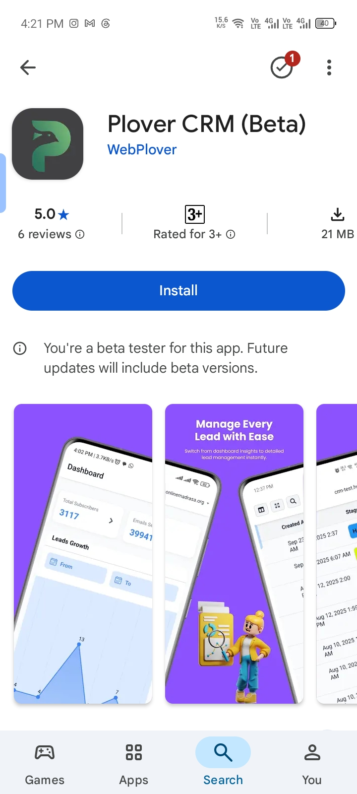
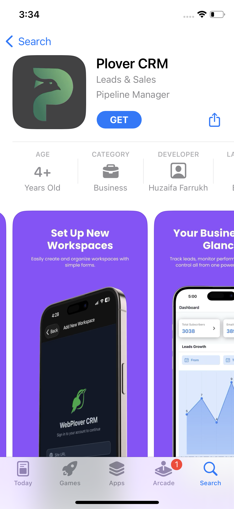

# Download PloverCRM

Install the PloverCRM mobile app on an Android phone or an Apple device. The app is available from the Google Play Store and the Apple App Store.

## Before you start

- Use an Android phone or tablet for the Google Play Store version.
- Use an iPhone or iPad for the Apple App Store version.
- Make sure your device has an internet connection.
- Use the store account associated with your device.

## Download the Android app

1. Open the [PloverCRM listing in the Google Play Store](https://play.google.com/store/apps/details?id=com.webplver.fluentcrmmobileapp).
2. Confirm that the app listing is for PloverCRM.
3. Tap **Install**.
4. Wait for the installation to finish.
5. Tap **Open** to launch PloverCRM.

## Download the Apple app

1. Open the [PloverCRM listing in the Apple App Store](https://apps.apple.com/app/webplover-crm/id6752574191).
2. Confirm that the app listing is for PloverCRM.
3. Tap **Get**.
4. Authenticate with Face ID, Touch ID, or your Apple Account password if requested.
5. Wait for the installation to finish.
6. Tap **Open** to launch PloverCRM.

## What happens next

After opening the app, the PloverCRM login screen appears. You will need the site URL, username, and password created for your PloverCRM workspace before you can sign in.

Continue with [Create a PloverCRM Account and Log In](02-create-a-plovercrm-account-and-log-in.md).

## Troubleshooting

### The store listing does not open

- Confirm that your device has an internet connection.
- Open the store app manually and search for **PloverCRM**.
- Make sure you are using the correct store for your device.

### The app cannot be installed

- Check that your device has enough available storage.
- Install any pending operating-system updates.
- Check whether your device is compatible with the current app version.
- Try the installation again from the official store listing.

### You installed the app but do not have login details

PloverCRM login details are created for a connected workspace. Continue to the account and login article, or ask your site administrator for the correct site URL, username, and password.

## Related articles

- [Create a PloverCRM Account and Log In](02-create-a-plovercrm-account-and-log-in.md)
- [Reset Your Mobile App Password](03-reset-your-mobile-app-password.md)
