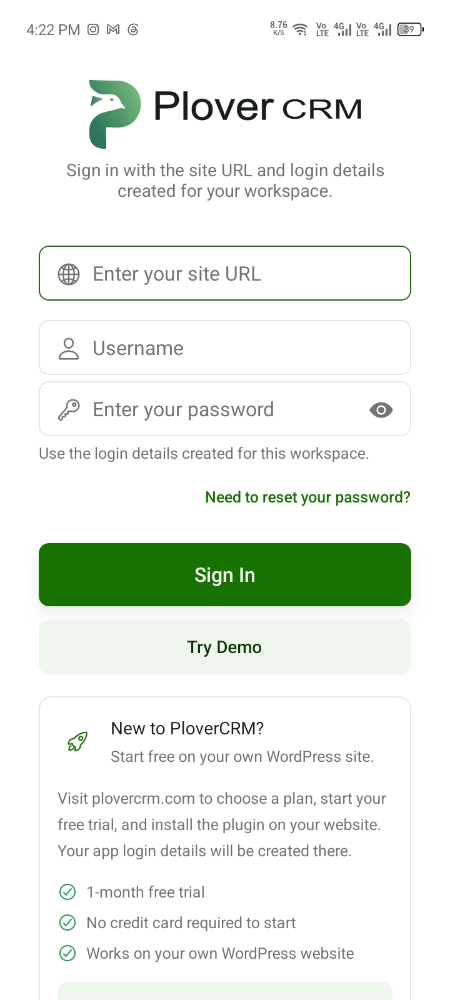

# Create a PloverCRM Account and Log In

Create your PloverCRM account and then use the workspace login details to sign in to the mobile app.

## Before you start

- Install the PloverCRM mobile app.
- Have access to the WordPress website that will use PloverCRM.
- Have permission to set up PloverCRM on that website, or ask the site administrator to complete the setup.
- Have your workspace site URL, username, and password available.

> **Important:** The mobile app does not show an in-app account-creation form. Create your PloverCRM account and workspace through the PloverCRM website and complete the required website setup before signing in from mobile.

## Create your PloverCRM account

1. Open [plovercrm.com](https://plovercrm.com/).
2. Choose the option to start a free trial or create your PloverCRM account.
3. Follow the website instructions to enter your account details.
4. Install and connect the PloverCRM plugin on your WordPress website when prompted.
5. Complete the required workspace setup.
6. Keep the site URL and login details available for the mobile sign-in screen.

For WordPress setup instructions, see [Download, Install, and Connect the PloverCRM Plugin](../../02-plovercrm-web/01-getting-started/03-download-the-plovercrm-plugin.md) and [Complete Guided Workspace Setup](../../02-plovercrm-web/01-getting-started/04-complete-guided-workspace-setup.md).

## Log in to the mobile app

1. Open PloverCRM.
2. In **Enter your site URL**, enter the website address connected to your PloverCRM workspace.
3. In **Username**, enter the username created for the workspace.
4. In **Enter your password**, enter the workspace password.
5. Tap **Sign In**.
6. Wait while PloverCRM connects to the website and loads the workspace information.

## What happens after you sign in

PloverCRM checks the website address and login details, then loads the workspace information needed by the mobile app. When the connection succeeds, the app opens the Dashboard.

The workspace data loaded by the app can include your profile, leads, lists, tags, fields, stages, business information, notification settings, and other workspace configuration.

If the workspace is already saved on your device, PloverCRM updates its saved connection details and provides an **Open workspace →** option.

## Try the demo workspace

If you want to explore the app before connecting your own website, tap **Try Demo** on the login screen. The demo option opens a temporary demo workspace when one is available.

Do not use the demo workspace for private customer information or real business data.

## Troubleshooting

### The site URL is rejected

- Check that you entered the website address correctly.
- Include the correct domain, such as `example.com` or the full website address requested by your administrator.
- Make sure the website is connected to PloverCRM.

### The username or password is rejected

The app displays **Invalid username or password. Please try again.** Check your credentials and try again. If you cannot remember the password, use [Reset Your Mobile App Password](03-reset-your-mobile-app-password.md).

### The app cannot find the website

The app displays **We couldn't find your site. Please check if the website address is correct.** Confirm the site URL with your site administrator.

### The app cannot connect to the website

- Check your internet connection.
- Confirm that the website is online.
- Try again after a short wait.
- Ask your site administrator to confirm that PloverCRM is installed and connected on the website.

### You do not have CRM access

If the account does not have access to the workspace, the app may display a message asking you to contact the site administrator. Ask the administrator to confirm your PloverCRM access and workspace permissions.

## Related articles

- [Download PloverCRM](01-download-plovercrm.md)
- [Reset Your Mobile App Password](03-reset-your-mobile-app-password.md)
- [Manage Your Profile](../05-settings-and-preferences/02-manage-your-profile.md)
- [Manage Workspaces](../05-settings-and-preferences/04-manage-workspaces.md)
