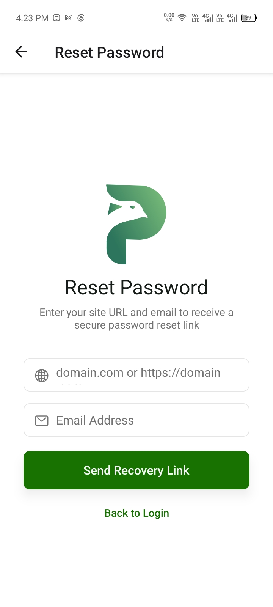

# Reset Your Mobile App Password

Use the password-recovery screen when you cannot remember the password for your PloverCRM workspace.

The recovery process requires the website address connected to your workspace and the email address associated with your account.

## Before you start

- Know the website address connected to your PloverCRM workspace.
- Have access to the email inbox associated with your account.
- Make sure your device has an internet connection.

## Request a password-reset link

1. Open PloverCRM.
2. On the login screen, tap **Need to reset your password?**.
3. In the website field, enter your site address.
4. In **Email Address**, enter the email address associated with your PloverCRM account.
5. Tap **Send Recovery Link**.
6. Check your email inbox for the secure password-reset message.
7. Open the link in the email and follow the instructions to create a new password.
8. Return to PloverCRM and sign in with the new password.

## What happens after you request recovery

If the request is accepted, check the email inbox associated with your PloverCRM account for the secure password-reset link. The confirmation screen and email-reset flow are not illustrated here because a confirmation screenshot is not currently available.

## What happens next

The password is created through the secure link sent by email. After creating the new password, return to the mobile app and sign in again.

The mobile recovery screen does not display the password requirements for the new password. Follow the requirements shown on the secure reset page.

## Troubleshooting

### A required field is missing

Enter both the website address and email address before tapping **Send Recovery Link**.

### The email address is rejected

Enter a valid email address, such as `name@example.com`, without spaces or extra characters.

### The website address is not found

The app may display **We couldn't find your site. Please check if the website address is correct.** Confirm the address with your site administrator and submit the request again.

### You receive a connection error

- Check your internet connection.
- Confirm that the website is online.
- Try the request again later.

### You tried too many times

The app may display **Too many reset attempts. Please try again later.** Wait before submitting another request.

### You do not receive an email

- Check your spam, junk, or promotions folders.
- Confirm that you entered the email address associated with the workspace.
- Confirm the site URL is correct.
- Wait a few minutes and submit the request again if needed.
- Contact your site administrator or [PloverCRM Support](../../02-plovercrm-web/13-help-updates-and-account-support/02-contact-support.md) if you still cannot recover access.

## Related articles

- [Create a PloverCRM Account and Log In](02-create-a-plovercrm-account-and-log-in.md)
- [Manage Your Profile](../05-settings-and-preferences/02-manage-your-profile.md)
